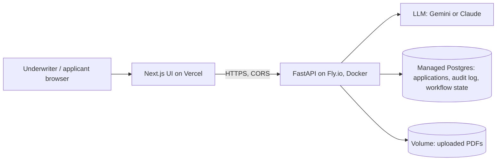

# Loan Intake Agent

An agentic workflow that turns messy loan documents (bank statements, pay stubs, W-2s) into a verified applicant profile with risk flags, then hands it to a human underwriter for the final decision.

> **All data is synthetic. No real PII.**

Status: under active development (1-week sprint). See `PLAN.md` and `STAGES.md`.

## Quick start
```
cp .env.example .env   # add your keys
uv sync
```

## Evals
`make eval-data` generates 30 synthetic applicants twice (clean text PDFs / heavy-noise scans, same ground truth); `make eval` scores models on them and rewrites [`evals/report.md`](evals/report.md). Raw model responses are committed, so results replay for free; only missing calls hit the API, capped by `BUDGET`.

| Model (30 applicants unless noted) | Clean | Noisy scans | Flag recall | Cost / applicant |
|---|---|---|---|---|
| Claude Haiku 5.5 | 100% | 98.2% | 100% | $0.0025 / $0.0076 |
| Gemini 3.5 flash-lite | 100% | 96.4% | 100% | $0.0128 / $0.0185 |
| Claude Sonnet 5.5 (10 applicants) | 100% | 99.5% | 100% | $0.0445 / $0.0883 |

Noisy flag precision (68-75% for the small models) is below the 85% target: misread scans cause false alarms that go to human review. Details and failure analysis in the report. CI replays the recordings offline (`make eval-ci`) and fails if accuracy or flag recall/precision drop below the recorded baseline.

## Architecture

Upload -> classify + extract (LLM, with validate-and-retry) -> rules raise evidence-linked flags -> workflow pauses for human review -> approve/reject, every edit audited.

## Run everything locally
```
cp .env.example .env    # add GEMINI_API_KEY (or ANTHROPIC_API_KEY + LLM_PROVIDER=anthropic)
docker compose up --build
```
UI http://localhost:3000 · API http://localhost:8000/docs. Only the UI is needed for styling work: `cd apps/web && npm run mock` (fake API, no Docker) plus `npm run dev`.

## Deploy
| Piece | Where | Notes |
|---|---|---|
| UI | Vercel, Root Directory `apps/web`, production branch `develop/loan-intake` | env `NEXT_PUBLIC_API_URL` = API URL (build-time, redeploy after changing) |
| API | Fly.io from the root `Dockerfile` (`fly.toml`) | secrets: `DATABASE_URL`, LLM key, `CORS_ORIGINS` = the Vercel URL |
| Database | Managed Postgres (tables are created on first start) | connection string in `DATABASE_URL` |
| PDFs | Fly volume mounted at `/data/uploads` | `UPLOADS_DIR`; object storage (R2/S3) is the upgrade path |

Order: database -> API (get its URL) -> UI with that URL -> set `CORS_ORIGINS` on the API to the UI URL.
Demo data: `uv run python scripts/seed_live.py --api https://<your-api>` uploads 4 synthetic applicants.

## Model picker and live stats
The Create application tab has a **Model** dropdown (Gemini, Groq Qwen, OpenRouter free vision models, Claude Haiku); a model is selectable once its API key is set (`GEMINI_API_KEY`, `GROQ_API_KEY`, `OPENROUTER_API_KEY`, `ANTHROPIC_API_KEY`). Each application records which model processed it, and the **Model stats** tab shows per-model latency, cost, tokens, extraction success and what underwriters did (fields corrected, flags dismissed). Live uploads have no answer key, so benchmark accuracy stays in the eval report. `scripts/check_models.py` smoke-tests a candidate model on one scanned document before you add it.
